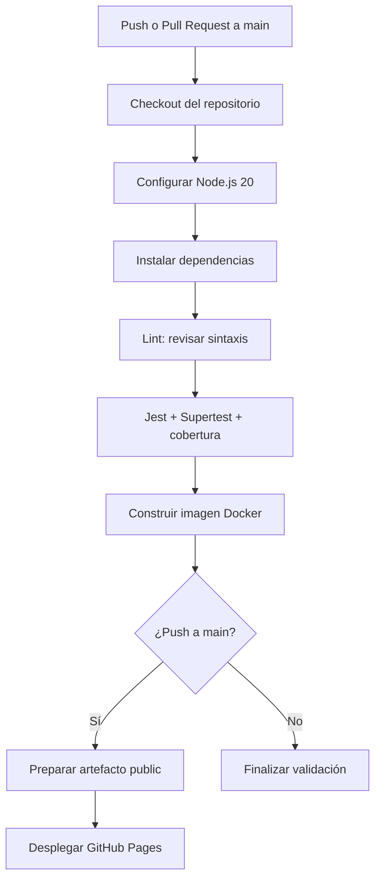

# Documentación del pipeline CI/CD

## Propósito
Automatizar la validación del proyecto en cada `push` a `main` y en cada Pull Request dirigido a `main`. El despliegue a GitHub Pages ocurre únicamente después de superar las validaciones y cuando el evento es un `push` a `main`.

## Flujo

## Etapas del workflow

1. **Trigger:** `push` y `pull_request` sobre `main` inician el workflow.
2. **Checkout:** `actions/checkout@v4` obtiene el código del repositorio.
3. **Node.js:** `actions/setup-node@v4` configura Node.js 20 en el runner Ubuntu.
4. **Instalación:** `npm install` instala Express, Jest y Supertest.
5. **Lint:** `npm run lint` utiliza `node --check` para verificar la sintaxis de los archivos principales.
6. **Pruebas:** `npm test` ejecuta Jest con Supertest y genera el reporte de cobertura.
7. **Docker:** `docker build` comprueba que la imagen de la API se pueda construir.
8. **Artefacto de cobertura:** se conserva el reporte como artefacto de Actions por siete días, incluso si una etapa anterior falla.
9. **Despliegue:** si las validaciones terminaron bien y el evento es un `push` a `main`, se publica el contenido de `public/` mediante GitHub Pages.

## Configuración de GitHub Pages
En el repositorio, abrir **Settings → Pages** y seleccionar **GitHub Actions** como fuente de publicación. El workflow requiere permisos `pages: write` e `id-token: write`.

## Interpretación de resultados
- **Verde:** las verificaciones y, cuando corresponde, el despliegue terminaron correctamente.
- **Rojo:** falló una etapa. Abrir el workflow, seleccionar el job y revisar el paso marcado como fallido.
- **Despliegue omitido:** es normal en Pull Requests; Pages solo se publica desde un `push` a `main`.

## Alcance y limitaciones
GitHub Pages aloja contenido estático; no ejecuta el servidor Node.js/Express. En Pages, el frontend cambia automáticamente a modo local y guarda las tareas en `localStorage` del navegador. La API Express puede ejecutarse por separado con `npm start` o dentro del contenedor Docker. La información de la API está almacenada en memoria y se pierde al reiniciar el proceso.
